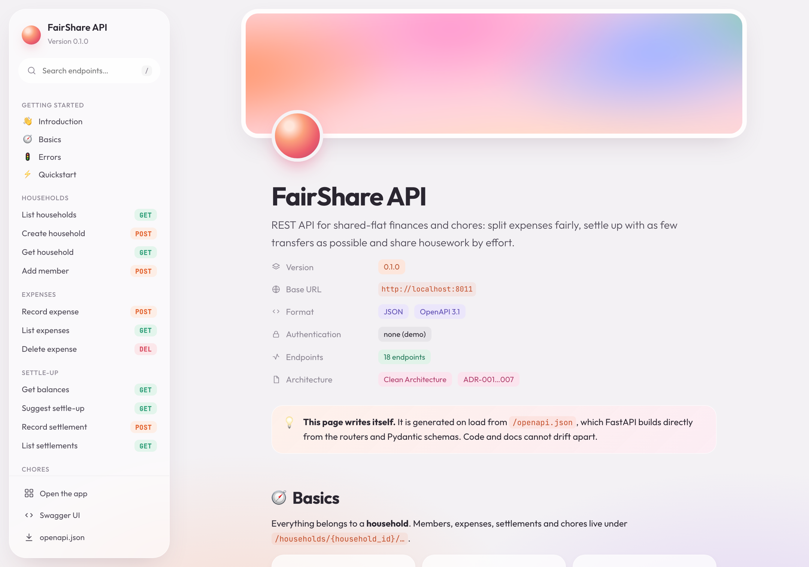
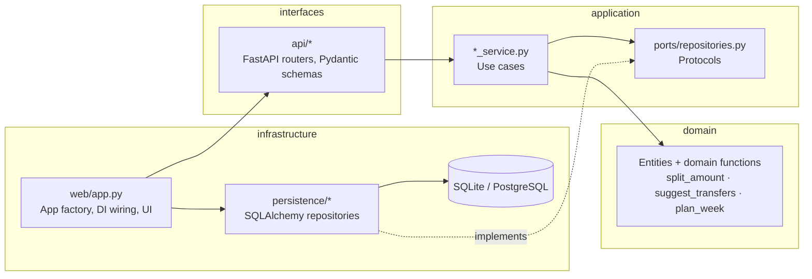
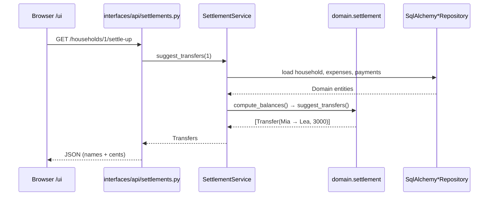
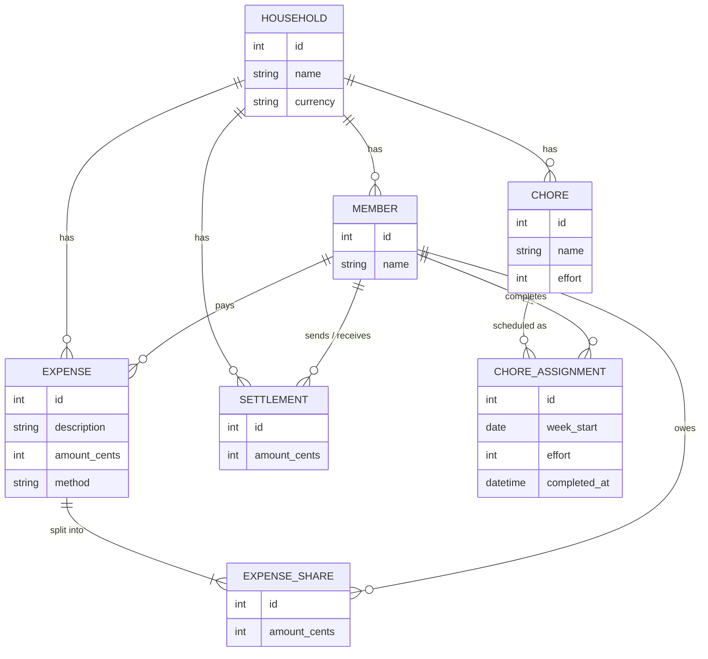
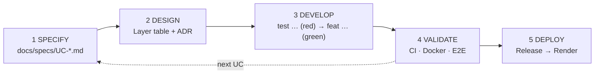
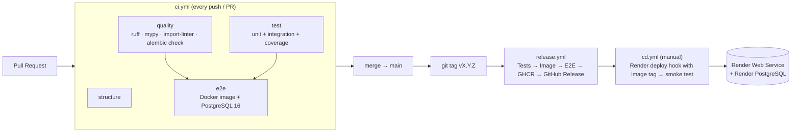

# FairShare

[](https://github.com/jasin-jusufi/fairshare/actions/workflows/ci.yml)
[](https://github.com/jasin-jusufi/fairshare/actions/workflows/release.yml)
[](https://ai-sdlc.aisl.science)


**FairShare** is an app for shared flats (a "WG" in Swiss German): split shared
expenses fairly, settle up with as few transfers as possible and distribute
chores fairly by effort. Built as the capstone project for the module
*AI-assisted Software Development* (FHNW, 26H2) with **Clean Architecture**,
**TDD**, **CI/CD** and consistent use of **coding agents** following the
[AI-SDLC](https://docs.aisl.science/learning-and-resources/ai-sdlc).


| | |
|---|---|
| **Team** | Jasin Jusufi, Bajram Kurto Elezi |
| **Stack** | Python 3.12 · FastAPI · SQLAlchemy 2 · Alembic · PostgreSQL / SQLite · Docker · GitHub Actions · Render |
| **Agents** | Claude Code (main agent), GitHub Copilot |
| **Live** | <https://fairshare-1u2q.onrender.com/ui/> (API reference: [`/docs`](https://fairshare-1u2q.onrender.com/docs), release [v0.1.0](https://github.com/jasin-jusufi/fairshare/releases/tag/v0.1.0); free Render plan, the first request after idling takes about 30 s) |

---

## Contents

1. [Problem and use cases](#1-problem-and-use-cases)
2. [Architecture](#2-architecture)
3. [Domain model](#3-domain-model)
4. [AI-assisted development](#4-ai-assisted-development)
5. [Tests and quality](#5-tests-and-quality)
6. [CI, release and deployment](#6-ci-release-and-deployment)
7. [Running locally](#7-running-locally)
8. [Project structure](#8-project-structure)

---

## 1. Problem and use cases

In shared flats, expenses are usually tracked in group chats or spreadsheets.
This leads to rounding differences ("who gets the extra cent?"), many small
transfers and an unequal share of the housework. FairShare solves three
non-trivial domain problems:

| UC | Use case | Domain core | Specification |
|---|---|---|---|
| 001 | Set up household | Members with unique names | [UC-001](docs/specs/UC-001-SETUP-HOUSEHOLD.md) |
| 002 | Record expense | Equal / percent / shares split, **largest remainder**: the shares always add up exactly | [UC-002](docs/specs/UC-002-RECORD-EXPENSE.md) |
| 003 | Settle up | Balances + **greedy settle-up with ≤ n − 1 transfers**, overpayment protection | [UC-003](docs/specs/UC-003-SETTLE-UP.md) |
| 004 | Rotate chores | **Fairness by effort** including history (LPT heuristic) | [UC-004](docs/specs/UC-004-ROTATE-CHORES.md) |
| 005 | Scan receipt | Suggestion from a receipt photo behind the **`ReceiptParser` port**; adapters: switched off, fake, local vision model (Ollama) or Claude; nothing stored | [UC-005](docs/specs/UC-005-SCAN-RECEIPT.md) |

**What is innovative?** The three core algorithms are pure, framework-free
domain functions and are tested with properties, not just examples: shares add
up exactly for every amount and every method, random households are always
settled with at most n − 1 payments, and over 12 simulated weeks the load
spread stays smaller than the most demanding chore.

---

### API reference

`/docs` serves a custom API reference in the FairShare design. It is generated
in the browser from `/openapi.json`, i.e. directly from the routers, docstrings
and Pydantic schemas, so code and documentation cannot drift apart. An
integration test checks that every endpoint has a summary, a description and
documented errors.



---

## 2. Architecture

Clean Architecture with four layers. Dependencies point inwards only
([ADR-001](docs/adr/ADR-001-clean-architecture.md)):



**The rule is enforced, not just documented.** `import-linter` checks two
contracts in CI and as a unit test (`tests/unit/test_architecture.py`):

1. *Layers:* `infrastructure → interfaces → application → domain`, never the other way round.
2. *Forbidden:* `domain` and `application` import neither FastAPI, Pydantic,
   SQLAlchemy nor Alembic.

If an agent breaks the architecture, the build turns red. This was the most
important guardrail for generated code.

**Request flow**, using "suggest settle-up" as an example:



### Architecture decisions (ADRs)

| ADR | Decision |
|---|---|
| [001](docs/adr/ADR-001-clean-architecture.md) | Clean Architecture, enforced by import-linter |
| [002](docs/adr/ADR-002-stack.md) | Python 3.12 + FastAPI + SQLAlchemy 2, mypy --strict |
| [003](docs/adr/ADR-003-persistence.md) | SQLite (dev/CI), PostgreSQL (prod), Alembic + drift check |
| [004](docs/adr/ADR-004-money-as-integer-cents.md) | Money as integer cents, largest remainder |
| [005](docs/adr/ADR-005-testing-strategy.md) | Test pyramid, visible TDD trail in Git |
| [006](docs/adr/ADR-006-delivery-pipeline.md) | GitHub Actions → GHCR → Render |
| [007](docs/adr/ADR-007-settle-up-algorithm.md) | Greedy settle-up instead of exact (NP-hard) optimization |
| [008](docs/adr/ADR-008-receipt-parser-port.md) | Receipt parsing behind a port, fake adapter instead of a real LLM |
| [009](docs/adr/ADR-009-local-vision-model.md) | Local vision model via Ollama: real AI without a key, offline |
| [010](docs/adr/ADR-010-claude-vision-adapter.md) | Claude as optional cloud adapter with structured output and a scan limit (USD 2 demo budget) |

---

## 3. Domain model

Seven entities, three value objects, five use case services.



| Service | Use cases | Key rules |
|---|---|---|
| `HouseholdService` | UC-001 | Names 1–80 characters, unique (case-insensitive) |
| `ExpenseService` | UC-002 | Payer and participants must be members; sum of shares = amount |
| `SettlementService` | UC-003 | Balances sum to 0; payment ≤ outstanding debt |
| `ChoreService` | UC-004 | Effort 1–5; each week can be planned only once; effort stored as a snapshot |
| `ReceiptService` | UC-005 | JPEG/PNG by file signature, ≤ 5 MB; suggestion: description 1–120 characters, amount > 0; nothing stored |

Error mapping at the HTTP boundary: `ValidationError` → 400, `NotFoundError` → 404,
`ConflictError` → 409, `ReceiptUnreadableError` → 422, `ParserUnavailableError` → 503.
The domain knows nothing about HTTP status codes.

---

## 4. AI-assisted development

We started the project from the
[AI-SDLC template](https://github.com/AIaSDev/ai-sdlc-template) and took
every use case through the same phases:



| Artifact | Purpose |
|---|---|
| [`AGENTS.md`](AGENTS.md) | Router for all agents: phases → skills, rules, **project-specific rules with ADR links** |
| `CLAUDE.md` → `@AGENTS.md`, `.github/copilot-instructions.md` | One rule set for Claude Code **and** Copilot |
| [`skills/ai-sdlc-*`](skills) (linked in `.claude/skills`, `.agents/skills`) | Phase instructions that the agent loads by itself |
| [`docs/TASKS.md`](docs/TASKS.md) | Current state + **log of every phase per use case** |
| [`docs/specs/`](docs/specs) | Executable specifications; acceptance criteria AC1…ACn = integration tests |
| [`docs/adr/`](docs/adr) | Architecture questions decided by humans |
| [`docs/AI-LOG.md`](docs/AI-LOG.md) | Request to the agent → result → **what we had to correct** |
| `.claude/settings.json` | Hook: agent edits are immediately formatted and checked with ruff |

**Guardrails instead of trust.** Agent code is only merged once ruff,
`mypy --strict`, import-linter, `alembic check`, the 90 % coverage gate and
E2E against PostgreSQL are green. Each use case is its own pull request whose
commit history shows the TDD cycle:

```text
docs(uc-003): specify settle-up and record ADR-007 greedy algorithm
test(uc-003): add failing tests for balances and settle-up (red)
feat(uc-003): compute balances, suggest minimal transfers, record settlements (green)
build(uc-003): add migration for settlements
docs(uc-003): record develop phase
```

**Where the agent got it wrong** (excerpt from the [AI-LOG](docs/AI-LOG.md)):
CI red because of an empty test folder that was not under version control; a
meaningless assertion in a generated test; the assumption that amounts are
sent over the API as CHF decimals. This led to the refined ADR-004.

---

## 5. Tests and quality

| Level | Count | What | How |
|---|---|---|---|
| Unit | 294 | Domain rules, algorithms (including property tests with fixed seeds), use cases with in-memory repositories, architecture contracts, edge cases | `pytest tests/unit` |
| Integration | 113 | Every acceptance criterion via HTTP + real DB (SQLite in-memory), edge cases | `pytest tests/integration` |
| E2E | 7 | API journey and **browser journeys through the UI with Playwright** (household, quick add, settle up, fair chore plan, receipt scan) against the **running Docker container with PostgreSQL** | `BASE_URL=… pytest tests/e2e` |

Coverage: **99 %** (gate 90 %). Static checks: `ruff`, `mypy --strict`,
`lint-imports`, `alembic check`.

```bash
ruff check . && ruff format --check . && mypy && lint-imports
pytest tests/unit tests/integration --cov
```

### Testing

**Install** (once): pytest, coverage and the linters come from `requirements-dev.txt`.

```bash
bash scripts/setup-python.sh && source .venv/bin/activate     # Linux / macOS
```

```powershell
py -3.12 -m venv .venv; .venv\Scripts\Activate.ps1            # Windows
python -m pip install -r requirements-dev.txt
```

**Run**: `pyproject.toml` already puts `src` on the path, so no `PYTHONPATH` is needed.

```bash
pytest tests/unit tests/integration                           # what CI runs
pytest tests/unit/edge_cases tests/integration/edge_cases -rx  # edge cases + list of known bugs
pytest tests/unit tests/integration --cov                     # with coverage report
pytest -k boundary -v                                         # select tests by name
```

**Edge-case suite.** Besides the acceptance criteria, `tests/*/edge_cases/` checks
empty input, boundary values, wrong data types, very large numbers and Unicode:

| File | Tests | Focus |
|---|---|---|
| `unit/edge_cases/test_split_edge_cases.py` | 77 | 1 cent, single participant, 99/100/101 %, property: every share within 1 cent of the exact value |
| `unit/edge_cases/test_text_edge_cases.py` | 13 | Name length 80/81, Unicode whitespace, umlauts and emoji, ß/ss, invisible characters, NFC/NFD |
| `unit/edge_cases/test_settlement_edge_cases.py` | 6 | Empty household, 1-cent debt, no side effects, 50 members, balances always sum to 0 |
| `unit/edge_cases/test_chore_edge_cases.py` | 11 | Effort 1 and 5, first/last calendar date, leap day, ties, new and former members |
| `integration/edge_cases/test_input_types_api.py` | 30 | Wrong types, missing fields and malformed JSON → 422; booleans as numbers |
| `integration/edge_cases/test_limits_api.py` | 19 | Length and amount boundaries, data isolation between households, huge IDs and amounts |
| `integration/edge_cases/test_consistency_api.py` | 2 | 40 random expenses settled via the suggested transfers; deleting a settled expense |

**Known bugs** are marked as strict `xfail` in [`tests/known_bugs.py`](tests/known_bugs.py):
the build stays green while a bug is open and turns red once it is fixed, as a reminder
to remove the marker. The suite found five bugs (BUG-1 … BUG-5); all are fixed with
red → green commits, so no marker is in use. Every test case, its input and its result are listed in
[`docs/TEST-PROTOCOL.md`](docs/TEST-PROTOCOL.md).

---

## 6. CI, release and deployment



- **Branch protection on `main`:** changes only via pull request; `structure`, `quality`, `test` and `e2e` must pass on an up-to-date branch; no force pushes or deletions, enforced for admins too.
- **Release:** `git tag v1.0.0 && git push origin v1.0.0` → `ghcr.io/jasin-jusufi/fairshare:v1.0.0`
- **Deployment:** *Actions → CD → Run workflow* with an image tag. On startup the container runs `alembic upgrade head`.

### Setting up Render (one-time)

1. GitHub: after the first release, make the package `fairshare` public
   (*Packages → fairshare → Package settings → Change visibility*), so Render can pull it.
2. Render: *New → Blueprint*, select this repository. [`render.yaml`](render.yaml)
   creates the PostgreSQL database and the web service from
   `ghcr.io/jasin-jusufi/fairshare:latest` with `DATABASE_URL` and health check `/health`.
3. Render: copy *fairshare → Settings → Deploy Hook*.
4. GitHub: environment `production` with secret `RENDER_DEPLOY_HOOK_URL`,
   variables `APP_URL` (e.g. `https://fairshare.onrender.com`) and `CD_ENABLED=true`.

The Blueprint uses Render's free plans, which suit the course demo: the free
database expires after 30 days. For real use, switch `plan` in `render.yaml`
to a paid tier before creating the Blueprint.

Manual alternative to step 2: create the database and an *Existing Image* web
service by hand with the same settings.

---

## 7. Running locally

```bash
bash scripts/setup-python.sh          # .venv + dependencies
source .venv/bin/activate
PYTHONPATH=src uvicorn app.main:app --reload
RECEIPT_PARSER=claude PYTHONPATH=src uvicorn app.main:app --reload # receipt reading with Claude (UC-005)
RECEIPT_PARSER=ollama PYTHONPATH=src uvicorn app.main:app --reload # receipt reading, fully local
```

- UI: <http://localhost:8000/ui/>
- API reference: <http://localhost:8000/docs> (custom page, generated live from OpenAPI, with "Try it")
- Swagger UI: <http://localhost:8000/swagger>
- Health: <http://localhost:8000/health>

With Docker:

```bash
docker build -t fairshare .
docker run -p 8000:8000 fairshare                                   # SQLite inside the container
docker run -p 8000:8000 -e DATABASE_URL=postgresql://u:p@host/db fairshare
```

Configuration via environment variables only: `DATABASE_URL` (default
`sqlite:///./fairshare.db`), `PORT` (container, default 8000), `RECEIPT_PARSER`,
`OLLAMA_URL`, `OLLAMA_MODEL`, `ANTHROPIC_API_KEY`, `CLAUDE_MODEL` and
`CLAUDE_MAX_SCANS`. Locally they can also live in a git-ignored `.env`. No
secrets in the repo.

| `RECEIPT_PARSER` | Behaviour of "Scan receipt" (`POST /households/{id}/receipts`) |
|---|---|
| `none` (default) | Switched off, answers 503 (CI, Render) |
| `fake` | Tests and fallback: suggests "Migros", CHF 23.50 for every JPEG/PNG |
| `ollama` | Real AI, fully local: a vision model in [Ollama](https://ollama.com) reads merchant and total ([ADR-009](docs/adr/ADR-009-local-vision-model.md)) |
| `claude` | Real AI in the cloud: Claude reads merchant and total, best accuracy, needs `ANTHROPIC_API_KEY` ([ADR-010](docs/adr/ADR-010-claude-vision-adapter.md)) |

Receipt scanning with a local model, no API key and no cloud:

```bash
ollama pull qwen2.5vl:7b                 # once, about 6 GB
RECEIPT_PARSER=ollama PYTHONPATH=src uvicorn app.main:app --reload
```

`OLLAMA_URL` (default `http://localhost:11434`) and `OLLAMA_MODEL` (default
`qwen2.5vl:7b`) point to another server or model. The first scan loads the model
and takes longer; later scans take a few seconds.

Receipt scanning with Claude (photos are sent to Anthropic):

```bash
echo "ANTHROPIC_API_KEY=sk-ant-..." >> .env   # git-ignored, never commit it
RECEIPT_PARSER=claude PYTHONPATH=src uvicorn app.main:app --reload
```

`CLAUDE_MODEL` defaults to `claude-sonnet-5-5`; `CLAUDE_MAX_SCANS` (default 30)
stops API calls per server process, so the demo stays within its USD 2 budget.
Set a spend limit in the Anthropic Console as the hard stop.

### Agent setup

```bash
bash scripts/setup-skills.sh claude    # or: copilot, all
```

Then, for example in Claude Code: *"Execute phase 1 of AI-SDLC: …"* – see
[`AGENTS.md`](AGENTS.md).

---

## 8. Project structure

```text
src/app/
├── domain/            household · expense · settlement · chore · errors · validation
├── application/       *_service.py · ports/repositories.py · lookup · errors
├── interfaces/api/    households · expenses · settlements · chores · schemas · errors
├── infrastructure/    config · database · persistence/* · web/app.py · web/static
└── main.py
tests/{unit,integration,e2e}
migrations/            Alembic
docs/{specs,adr}       Specifications, decisions
docs/{TASKS,PROJECT,AI-LOG}.md
skills/                AI-SDLC phases (template)
.github/workflows/     ci · release · cd
```

---

Method: *The AI-SDLC Template and Method* (Martin & Schwander, 2026), see
[`CITATION.cff`](CITATION.cff).
