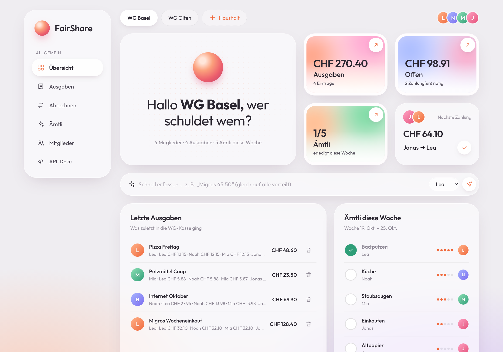
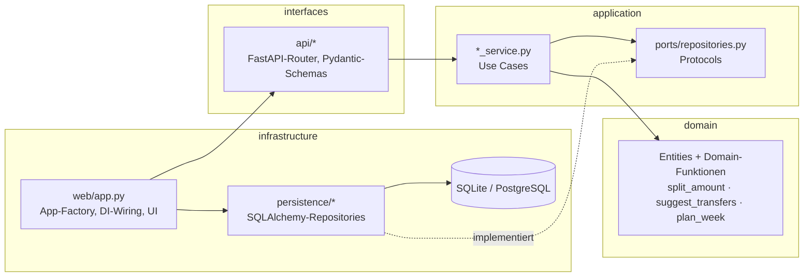
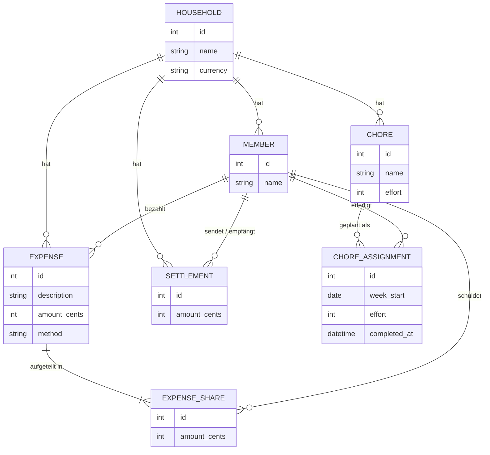
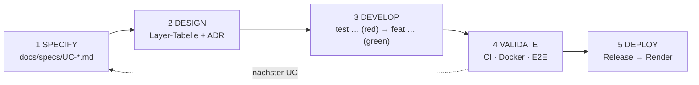
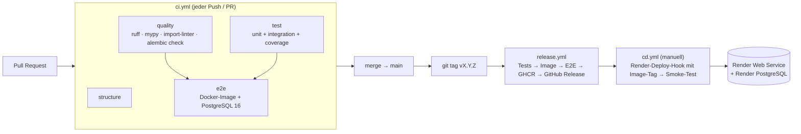

# FairShare

[](https://github.com/jasin-jusufi/fairshare/actions/workflows/ci.yml)
[](https://github.com/jasin-jusufi/fairshare/actions/workflows/release.yml)
[](https://ai-sdlc.aisl.science)


**FairShare** ist eine WG-Verwaltung: gemeinsame Ausgaben fair aufteilen, mit
möglichst wenigen Überweisungen abrechnen und Ämtli nach Aufwand gerecht
verteilen. Gebaut als Capstone-Projekt im Modul *AI-assisted Software
Development* (FHNW, 26H2) mit **Clean Architecture**, **TDD**, **CI/CD** und
konsequentem Einsatz von **Coding Agents** nach dem
[AI-SDLC](https://docs.aisl.science/learning-and-resources/ai-sdlc).



| | |
|---|---|
| **Team** | Jasin Jusufi, Bajram Kurto Elezi |
| **Stack** | Python 3.12 · FastAPI · SQLAlchemy 2 · Alembic · PostgreSQL / SQLite · Docker · GitHub Actions · Render |
| **Agents** | Claude Code (Hauptagent), GitHub Copilot |
| **Live** | siehe Repository-Variable `APP_URL` / Environment *production* |

---

## Inhalt

1. [Problem und Use Cases](#1-problem-und-use-cases)
2. [Architektur](#2-architektur)
3. [Domänenmodell](#3-domänenmodell)
4. [AI-assisted Development](#4-ai-assisted-development)
5. [Tests und Qualität](#5-tests-und-qualität)
6. [CI, Release und Deployment](#6-ci-release-und-deployment)
7. [Lokal starten](#7-lokal-starten)
8. [Projektstruktur](#8-projektstruktur)

---

## 1. Problem und Use Cases

In WGs werden Ausgaben meist im Chat oder in Tabellen verwaltet. Das führt zu
Rundungsdifferenzen („wer bekommt den Rappen?“), zu vielen kleinen
Überweisungen und zu ungleich verteilter Hausarbeit. FairShare löst drei
fachlich nicht-triviale Probleme:

| UC | Use Case | Fachlicher Kern | Spezifikation |
|---|---|---|---|
| 001 | Haushalt einrichten | Mitglieder mit eindeutigen Namen | [UC-001](docs/specs/UC-001-SETUP-HOUSEHOLD.md) |
| 002 | Ausgabe erfassen | Split gleich / Prozent / Anteile, **Largest-Remainder**: die Summe der Anteile stimmt immer exakt | [UC-002](docs/specs/UC-002-RECORD-EXPENSE.md) |
| 003 | Abrechnen | Salden + **Greedy-Ausgleich mit ≤ n − 1 Überweisungen**, Überzahlungsschutz | [UC-003](docs/specs/UC-003-SETTLE-UP.md) |
| 004 | Ämtli verteilen | **Fairness nach Aufwand** inkl. Historie (LPT-Heuristik) | [UC-004](docs/specs/UC-004-ROTATE-CHORES.md) |

**Was ist innovativ?** Die drei Kernalgorithmen sind reine, framework-freie
Domain-Funktionen und werden mit Eigenschaften getestet, nicht nur mit
Beispielen: Anteile summieren sich für jeden Betrag und jede Methode exakt,
zufällige Haushalte werden immer mit höchstens n − 1 Zahlungen ausgeglichen,
und über 12 simulierte Wochen bleibt die Lastspanne kleiner als das
aufwändigste Ämtli.

---

## 2. Architektur

Clean Architecture mit vier Layern. Abhängigkeiten zeigen nur nach innen
([ADR-001](docs/adr/ADR-001-clean-architecture.md)):



**Die Regel wird erzwungen, nicht nur dokumentiert.** `import-linter` prüft
zwei Verträge in CI und als Unit-Test (`tests/unit/test_architecture.py`):

1. *Layers:* `infrastructure → interfaces → application → domain`, nie umgekehrt.
2. *Forbidden:* `domain` und `application` importieren weder FastAPI, Pydantic,
   SQLAlchemy noch Alembic.

Bricht ein Agent die Architektur, wird der Build rot. Das war die wichtigste
Leitplanke für generierten Code.

**Request-Fluss** am Beispiel „Ausgleich vorschlagen“:


### Architekturentscheide (ADRs)

| ADR | Entscheid |
|---|---|
| [001](docs/adr/ADR-001-clean-architecture.md) | Clean Architecture, durch import-linter erzwungen |
| [002](docs/adr/ADR-002-stack.md) | Python 3.12 + FastAPI + SQLAlchemy 2, mypy --strict |
| [003](docs/adr/ADR-003-persistence.md) | SQLite (Dev/CI), PostgreSQL (Prod), Alembic + Drift-Check |
| [004](docs/adr/ADR-004-money-as-integer-cents.md) | Geld als ganzzahlige Rappen, Largest-Remainder |
| [005](docs/adr/ADR-005-testing-strategy.md) | Testpyramide, sichtbarer TDD-Trail in Git |
| [006](docs/adr/ADR-006-delivery-pipeline.md) | GitHub Actions → GHCR → Render |
| [007](docs/adr/ADR-007-settle-up-algorithm.md) | Greedy-Ausgleich statt exakter (NP-schwerer) Optimierung |

---

## 3. Domänenmodell

Sieben Entities, zwei Value Objects, vier Use-Case-Services.



| Service | Use Cases | Wichtige Regeln |
|---|---|---|
| `HouseholdService` | UC-001 | Namen 1–80 Zeichen, eindeutig ohne Gross-/Kleinschreibung |
| `ExpenseService` | UC-002 | Zahler und Beteiligte müssen Mitglieder sein; Summe der Anteile = Betrag |
| `SettlementService` | UC-003 | Salden summieren sich zu 0; Zahlung ≤ offene Schuld |
| `ChoreService` | UC-004 | Aufwand 1–5; jede Woche nur einmal planbar; Aufwand als Snapshot |

Fehler-Mapping an der HTTP-Grenze: `ValidationError` → 400, `NotFoundError` → 404,
`ConflictError` → 409. Die Domäne kennt keine HTTP-Codes.

---

## 4. AI-assisted Development

Wir haben das Projekt aus dem
[AI-SDLC-Template](https://github.com/AIaSDev/ai-sdlc-template) gestartet und
jeden Use Case durch dieselben Phasen geführt:



| Artefakt | Zweck |
|---|---|
| [`AGENTS.md`](AGENTS.md) | Router für alle Agents: Phasen → Skills, Regeln, **projektspezifische Regeln mit ADR-Links** |
| `CLAUDE.md` → `@AGENTS.md`, `.github/copilot-instructions.md` | Ein Regelwerk für Claude Code **und** Copilot |
| [`skills/ai-sdlc-*`](skills) (verlinkt in `.claude/skills`, `.agents/skills`) | Phasen-Anleitungen, die der Agent selbst lädt |
| [`docs/TASKS.md`](docs/TASKS.md) | Aktueller Zustand + **Log jeder Phase pro Use Case** |
| [`docs/specs/`](docs/specs) | Ausführbare Spezifikationen; Akzeptanzkriterien AC1…ACn = Integrationstests |
| [`docs/adr/`](docs/adr) | Von Menschen entschiedene Architekturfragen |
| [`docs/AI-LOG.md`](docs/AI-LOG.md) | Auftrag an den Agent → Ergebnis → **was wir korrigieren mussten** |
| `.claude/settings.json` | Hook: Agent-Edits werden sofort mit ruff formatiert und geprüft |

**Leitplanken statt Vertrauen.** Agent-Code wird erst gemergt, wenn ruff,
`mypy --strict`, import-linter, `alembic check`, der 90-%-Coverage-Gate und
E2E gegen PostgreSQL grün sind. Jeder Use Case ist ein eigener Pull Request,
dessen Commit-Historie den TDD-Zyklus zeigt:

```text
docs(uc-003): specify settle-up and record ADR-007 greedy algorithm
test(uc-003): add failing tests for balances and settle-up (red)
feat(uc-003): compute balances, suggest minimal transfers, record settlements (green)
build(uc-003): add migration for settlements
docs(uc-003): record develop phase
```

**Wo der Agent danebenlag** (Auszug aus dem [AI-LOG](docs/AI-LOG.md)):
CI rot wegen eines nicht versionierten leeren Testordners; eine sinnlose
Assertion in einem generierten Test; die Annahme, Beträge über die API als
CHF-Dezimalzahl zu übertragen. Daraus wurde der präzisierte ADR-004.

---

## 5. Tests und Qualität

| Ebene | Anzahl | Was | Wie |
|---|---|---|---|
| Unit | 131 | Domain-Regeln, Algorithmen (inkl. Property-Tests mit festen Seeds), Use Cases mit In-Memory-Repositories, Architekturverträge | `pytest tests/unit` |
| Integration | 39 | Jedes Akzeptanzkriterium über HTTP + echte DB (SQLite in-memory) | `pytest tests/integration` |
| E2E | 3 | Komplette Journey gegen den **laufenden Docker-Container mit PostgreSQL** | `BASE_URL=… pytest tests/e2e` |

Coverage: **99 %** (Gate 90 %). Statische Prüfungen: `ruff`, `mypy --strict`,
`lint-imports`, `alembic check`.

```bash
ruff check . && ruff format --check . && mypy && lint-imports
pytest tests/unit tests/integration --cov
```

---

## 6. CI, Release und Deployment



- **Release:** `git tag v1.0.0 && git push origin v1.0.0` → `ghcr.io/jasin-jusufi/fairshare:v1.0.0`
- **Deployment:** *Actions → CD → Run workflow* mit Image-Tag. Der Container führt beim Start `alembic upgrade head` aus.

### Render einrichten (einmalig)

1. Render: **PostgreSQL** anlegen, *Internal Database URL* kopieren.
2. Render: **Web Service → Existing Image** `ghcr.io/jasin-jusufi/fairshare:latest`
   (bei privatem Paket eine GHCR-Credential hinterlegen), Env `DATABASE_URL` = URL aus 1,
   Health Check Path `/health`.
3. Render: *Settings → Deploy Hook* kopieren.
4. GitHub: Environment `production` mit Secret `RENDER_DEPLOY_HOOK_URL`,
   Variablen `APP_URL` (z. B. `https://fairshare.onrender.com`) und `CD_ENABLED=true`.

---

## 7. Lokal starten

```bash
bash scripts/setup-python.sh          # .venv + Abhängigkeiten
source .venv/bin/activate
PYTHONPATH=src uvicorn app.main:app --reload
```

- UI: <http://localhost:8000/ui/>
- API-Doku (Swagger): <http://localhost:8000/docs>
- Health: <http://localhost:8000/health>

Mit Docker:

```bash
docker build -t fairshare .
docker run -p 8000:8000 fairshare                                   # SQLite im Container
docker run -p 8000:8000 -e DATABASE_URL=postgresql://u:p@host/db fairshare
```

Konfiguration nur über Umgebungsvariablen: `DATABASE_URL` (Default
`sqlite:///./fairshare.db`), `PORT` (Container, Default 8000). Keine Secrets im Repo.

### Agent-Setup

```bash
bash scripts/setup-skills.sh claude    # oder: copilot, all
```

Danach z. B. in Claude Code: *„Execute phase 1 of AI-SDLC: …“* – siehe
[`AGENTS.md`](AGENTS.md).

---

## 8. Projektstruktur

```text
src/app/
├── domain/            household · expense · settlement · chore · errors · validation
├── application/       *_service.py · ports/repositories.py · lookup · errors
├── interfaces/api/    households · expenses · settlements · chores · schemas · errors
├── infrastructure/    config · database · persistence/* · web/app.py · web/static
└── main.py
tests/{unit,integration,e2e}
migrations/            Alembic
docs/{specs,adr}       Spezifikationen, Entscheide
docs/{TASKS,PROJECT,AI-LOG}.md
skills/                AI-SDLC-Phasen (Template)
.github/workflows/     ci · release · cd
```

---

Methode: *The AI-SDLC Template and Method* (Martin & Schwander, 2026), siehe
[`CITATION.cff`](CITATION.cff).
